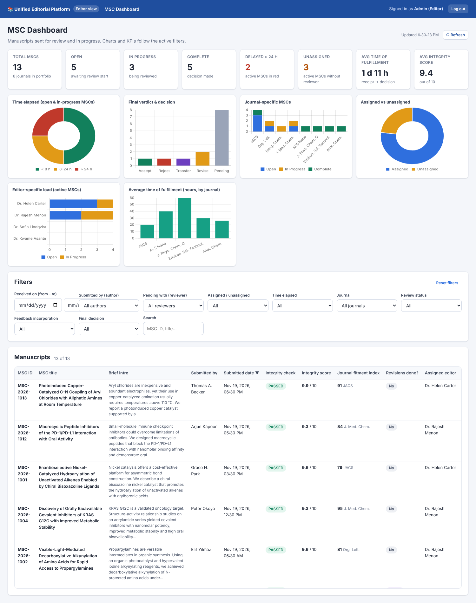
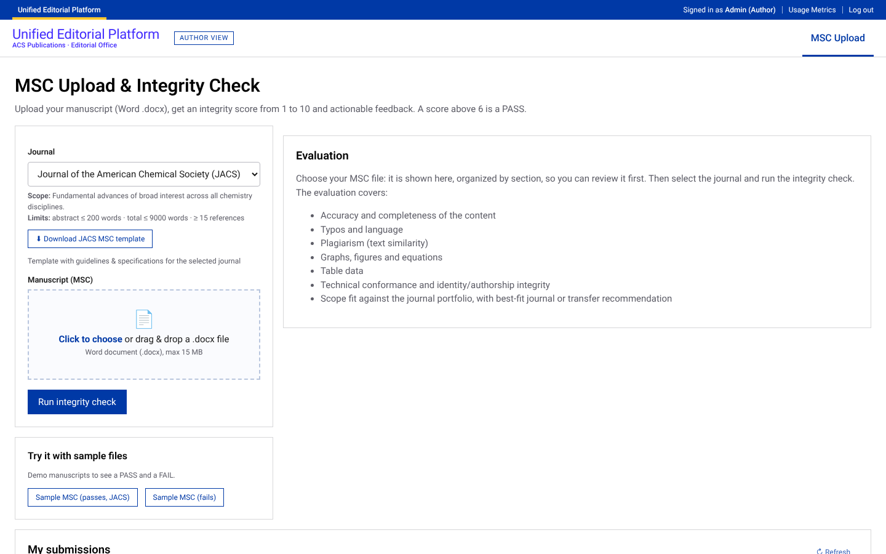
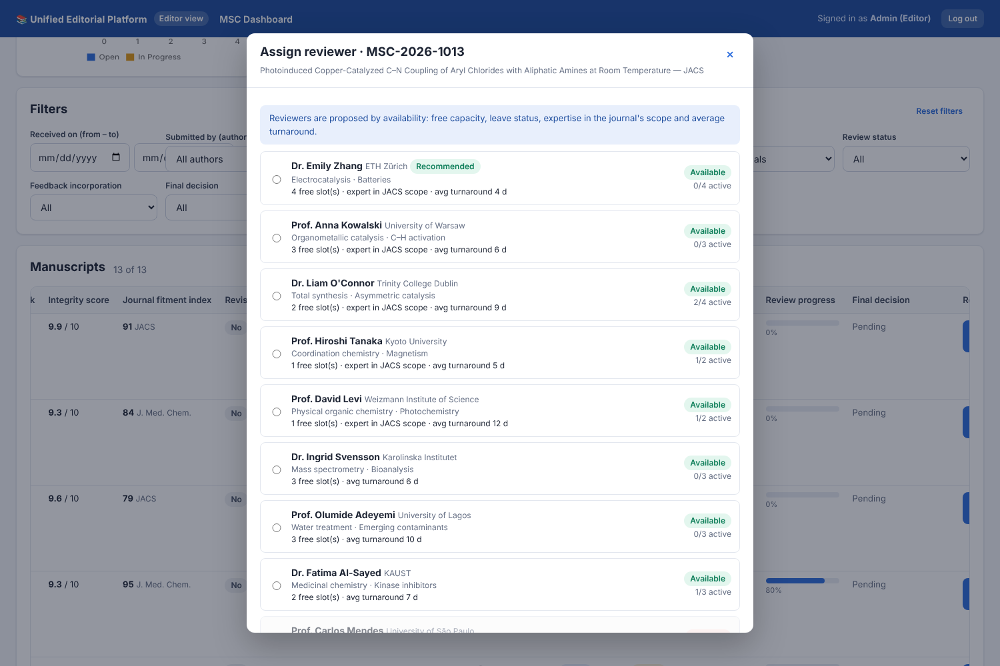
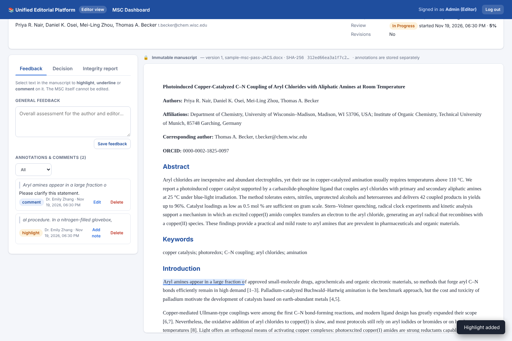
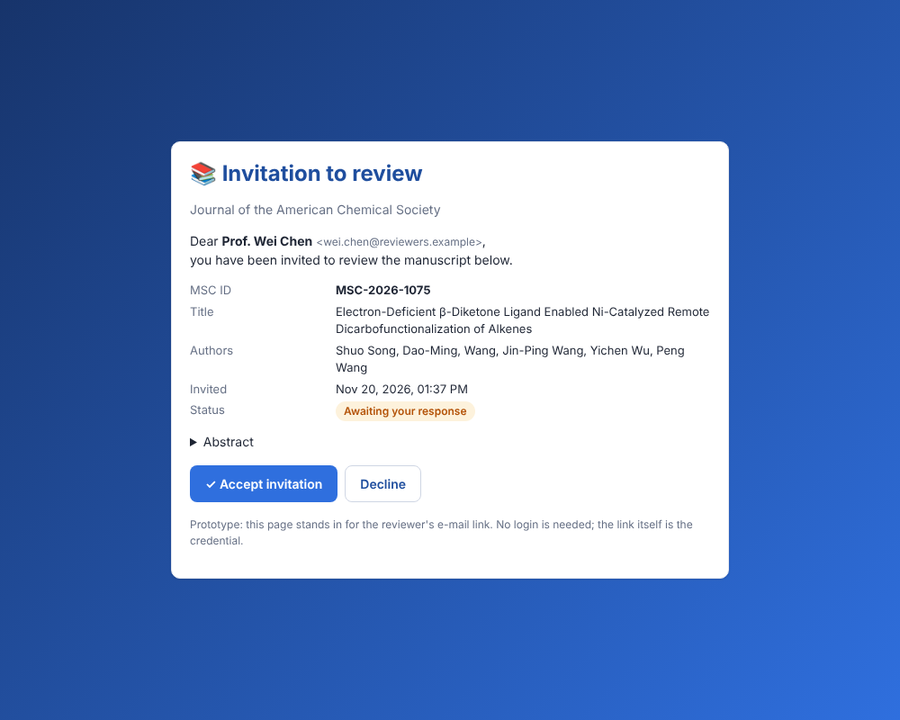
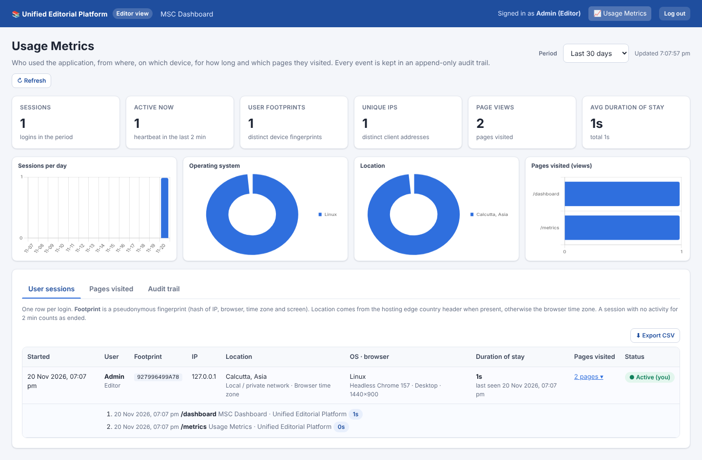
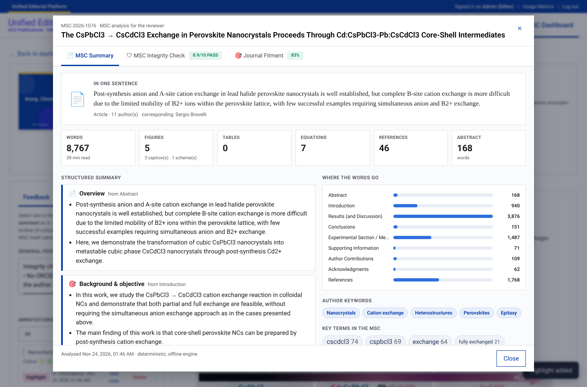
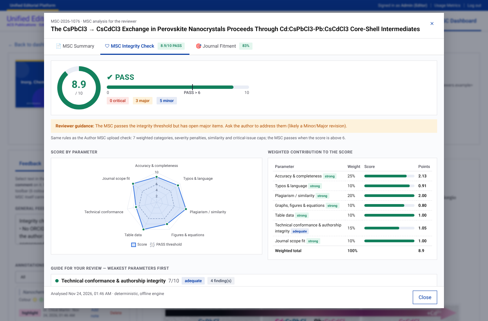
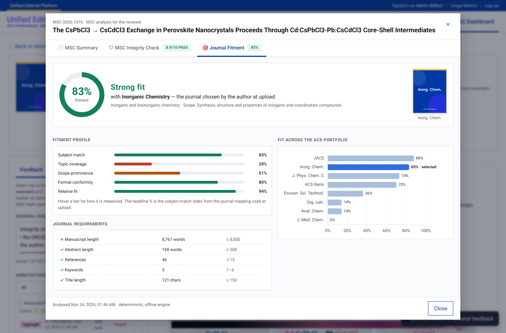
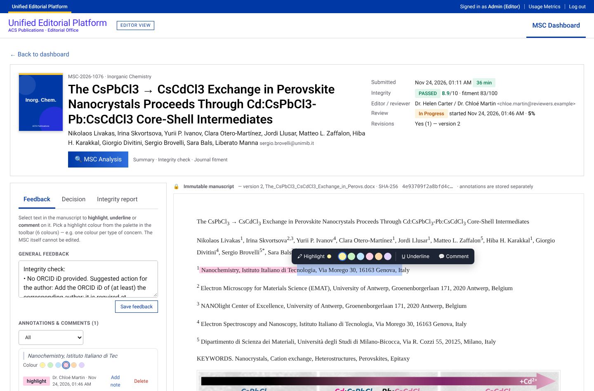

# Unified Editorial Platform: Working Prototype

A working prototype of the Unified Editorial Platform, built with **Node.js + Express**. It covers the full manuscript (MSC) flow:

* **Author view:** log in, choose a journal, download the journal's MSC template, upload an MSC (.docx), get an integrity score from 1 to 10 with actionable feedback, submit it (only above 6), and re-submit after a *Revise* decision.
* **Editor view:** log in, use the MSC dashboard (17-column table, filters, KPIs and charts), look up and assign reviewers in a modal, then review and annotate the immutable MSC and record the final decision (Accept / Reject / Transfer / Revise / Assign to PE).



## Quick start

Requirements: **Node.js 18 or newer** (tested on Node 22).

```bash
git clone https://github.com/avishek-tronc/Unified-Editorial-Platform-Prototype.git
cd Unified-Editorial-Platform-Prototype
npm install
npm start
```

Open **http://localhost:3000** and log in with **Admin / Admin**. On the login page, choose **Author** or **Editor** to pick the view.

On the first start the app seeds the demo database: 4 editors, 15 reviewers, 3 Publishing Editors and about 75 manuscripts. About **50 are Open / In Progress**, with a mix of on-track, attention and delayed times, assigned and unassigned. The other ~25 are review-complete over the past ~5 months. The manuscript content comes from the three sample MSCs in `samples/seed/` (`ja6c20962.docx`, `ja6c19336.docx`, `ja6c20174.docx`). Each one is run through the integrity engine for its target journals, so scores, fitment and the review pages are real, and the records reuse that content with different dates and states. Manuscript bodies are stored once per file in `data/contents/`. If you ran an earlier version, run `npm run reset` to pick up the new demo data.

| Command | What it does |
|---|---|
| `npm start` | Start the server (`PORT` env var, default 3000; `UEP_DATA_DIR` sets where data is stored) |
| `npm run dev` | Start with auto-reload on file changes |
| `npm run reset` | Delete all data and re-seed the demo database |
| `npm test` | End-to-end API smoke test of the author and editor flows (uses a temporary database) |
| `npm run samples` | Regenerate the demo .docx files in `samples/` |

### Demo walkthrough

1. **Author:** log in as Admin/Admin with *Author* selected.
   * Choose a journal (e.g. JACS) and click **Download JACS MSC template**.
   * Choose a file: the manuscript is shown first, organized by section. Then run the integrity check.
   * Upload `samples/sample-msc-fail.docx` (also downloadable from the page). It scores about **4/10: FAIL**, shows feedback for every check, and the submit button is disabled.
   * Upload `samples/sample-msc-pass-JACS.docx`. It scores about **9.9/10: PASS**. Click **Submit MSC for review**.
   * *My submissions* lists your MSCs. A seeded MSC already has a **Revise (Minor)** decision: click **Upload revision** to re-submit it.
2. **Editor:** log out, then log in as Admin/Admin with *Editor* selected.
   * The dashboard shows the new MSC as *Open* with a green time-elapsed badge.
   * Click **Look up reviewer** to open the modal. Each reviewer is listed with their e-mail address. Select one and click **✉ Send invitation e-mail**. The modal shows the e-mail that was sent.
   * Click **Open invitation link (as the reviewer)** and **Accept** the invitation on the page that opens (no login needed; the link is the credential). The dashboard then shows the reviewer as *✓ Accepted*.
   * Click **Review** (or the MSC ID). It is only enabled once the assigned reviewer has accepted the invitation. Select text in the manuscript and use **Highlight**, **Underline** or **Comment**. Write general feedback in the left pane. The reading progress is tracked as you scroll.
   * Open the **Decision** tab and choose Accept / Reject / Transfer / Revise. The alternate journal dropdown is only enabled for **Transfer**, and it is pre-filled with the system-proposed journal. **Revise** asks for Minor or Major and sends the MSC back to the author.

> Note: uploading the same manuscript again as a *new* submission is flagged by the plagiarism check, because it matches the earlier submission (duplicate-submission detection). Revisions of the same MSC are excluded from that comparison.

## Deploy to Render

The repo includes a [`render.yaml`](render.yaml) Blueprint, so Render can set everything up from it.

1. Sign in at [dashboard.render.com](https://dashboard.render.com) (signing in with GitHub is easiest).
2. Click **New +** → **Blueprint**.
3. Connect GitHub if asked, and give Render access to `Unified-Editorial-Platform-Prototype`.
4. Select the repository. Render reads `render.yaml` and shows one web service, **unified-editorial-platform**, on the free plan. Click **Apply** / **Deploy Blueprint**.
5. Wait for the build (`npm ci`) and the health check (`/healthz`) to go green. This takes a few minutes. Then open the `https://unified-editorial-platform-xxxx.onrender.com` URL shown on the service and log in with **Admin / Admin**.

Every push to `master` redeploys automatically.

What the Blueprint configures: Node 22, `npm ci` / `npm start`, `NODE_ENV=production` (secure session cookies), a generated `SESSION_SECRET`, and the `/healthz` health check. The app listens on Render's `PORT` variable.

**Data on Render.** Data is stored in `data/db.json` on the instance's local disk. On Render that disk is temporary: every redeploy or restart wipes it, and the free plan also restarts after about 15 minutes idle (the first request then takes about a minute to wake the service). When that happens the app re-seeds the demo manuscripts, and uploads, usage metrics, the audit trail, assignments, annotations and decisions are lost. Logged-in sessions are also held in memory, so users have to log in again. This is fine for demos. To keep data, use a paid instance with a [persistent disk](https://render.com/docs/disks) mounted at e.g. `/var/data` and set `UEP_DATA_DIR=/var/data` (commented out in `render.yaml`), or move `src/store.js` to a database such as Render PostgreSQL.

To start a demo from a clean slate at any time, use **Manual Deploy → Restart service**.

## How the spec maps to the prototype

### Login
* Single prototype account **Admin / Admin**, with a role toggle for the Author and Editor views (`POST /api/login`). Pages and APIs are protected by role.

### Author view: MSC upload page (`/author`)
| Spec item | Implementation |
|---|---|
| Upload MSC in Word format | Drag & drop / file picker. `.docx` up to 15 MB |
| Journal dropdown | 8-journal portfolio (`src/journals.js`) with scope, genre and limits |
| Download a template (e.g. JACS) | `GET /api/template/:journalId` generates a .docx with the required structure, grey placeholders and a *Guidelines & specifications* section |
| Article types | Full articles are checked for the IMRaD sections. Communications (abstract followed directly by the main text, e.g. JACS Communications) are recognised, so Introduction / Methods / Results / Conclusions headings are not required for them |
| Valid format & required details | Rejects non-.docx, legacy .doc, corrupted or renamed files, and documents without a body or under 200 words. Detects title, authors, affiliations, corresponding e-mail, ORCID and required sections |
| Integrity score 1–10 | Weighted score across 7 checks (below). **Above 6 = PASS**, so the author can submit. **6 or below** = the author must apply the feedback and re-submit (submit is blocked server-side too) |
| Organized MSC preview | As soon as a file is chosen, and before any integrity check or score, an *Uploaded MSC* pane at the top of the results column shows the manuscript read-only and organized into its parts: a title page (title, authors, affiliations, corresponding author, ORCID), then each recognised section with word, figure, table and reference counts. A section navigator jumps to each part and lists any missing required sections. Figures and tables are shown inline. The pane has its own **Run integrity check** button, and the score and feedback appear below it |
| Score + feedback | Score ring, PASS/FAIL verdict, per-category breakdown, issues ranked critical / major / minor, each with **How to fix** guidance, a journal-fit tab and an MSC details tab |

**Evaluation parameters** (`src/integrity.js`):

| # | Check | Weight | What is evaluated |
|---|---|---|---|
| i | Accuracy & completeness | 25% | Required sections, title length, abstract length and keyword count against journal limits, total word count, leftover template text, reference count, in-text citations ↔ reference list consistency, and quantitative claims in the abstract that are not supported in the body |
| ii | Typos | 10% | Common misspellings with suggestions, repeated words, double spaces, space before punctuation, unbalanced parentheses. Scored by density per 1,000 words |
| iii | Plagiarism | 20% | 8-word shingle similarity against a reference corpus and all prior submissions, with top matching sources and %. Over 25% caps the score at 4 |
| iv | Graphs, figures, equations | 10% | Embedded images vs. "Figure n." captions, sequential numbering, every figure cited, references to missing figures, Word equations referenced, equations typed as plain text |
| v | Table data | 10% | Tables vs. captions, tables pasted as images, empty cells, missing header row, non-numeric values in numeric columns, tables cited in text |
| vi | Technical conformance & identity/authorship integrity | 15% | Author list, affiliations, corresponding e-mail (flags personal domains), ORCID **checksum validation**, duplicate authors, document-metadata creator not in the author list, conflict of interest / data availability / author contributions statements, tracked changes, embedded comments |
| vii | Journal scope fit | 10% | Fitment index (0–100) for every journal in the portfolio from subject-term matching (title, abstract and keywords weighted higher). Recommends the best-fit journal and a **transfer path** when another journal fits clearly better |

Two or more critical issues cap the score at 5.

### Editor view: MSC dashboard (`/dashboard`)
* **Two tabs** split the table: **Open & In Progress** (default) and **Complete**, each with a live count.
* **Table** with the requested columns: MSC ID (a link to the review page when the review is Open / In Progress), title (the brief intro shows as a tooltip, so the table fits without a horizontal scroll), submitted by, submitted date, integrity check PASSED/FAILED, integrity score, journal fitment index (plus a "better fit" hint), revisions done, assigned editor, assigned reviewer, **reviewer lookup link (modal)**, review status (Open / In Progress / Complete), **time elapsed** colour-coded (green < 8 h, amber 8–24 h, red > 24 h), review start date/time, review progress bar, final decision, and a **Review** button. The Review button and the MSC ID link are only active when the review is Open / In Progress **and a reviewer is assigned** (otherwise shown as 🔒; the server also refuses review actions until a reviewer is assigned). The table shows **20 records per page** by default, with a 20 / 50 / 100 selector and page navigation. Columns are sortable.
* **Filters:** received on (date range), submitted by, pending with (reviewer), assigned/unassigned, time elapsed, journal, review status, feedback incorporation status, final decision, plus free-text search.
* **KPI tiles** (MSC count, Open, In Progress, Complete, delayed, unassigned, average fulfillment, average integrity score) stay visible at the top.
* **Charts** (Chart.js) sit in a collapsible **KPIs & Metrics** panel, collapsed by default (click its header to expand), and are recalculated for the active filters:
  * One compact row of six charts: time elapsed (Open & In Progress MSCs only; Complete MSCs are excluded), final verdict & decision, journal-specific MSCs, assigned vs unassigned, editor-specific load, average time of fulfillment. Clicking a chart segment applies the matching filter.
  * **MSCs received today:** total, a stacked progress bar and a bar chart by Open, In Progress, Completed and Delayed (still active after more than 8 hours).
  * **MSC processing outcome:** a stacked bar chart of review-complete MSCs by decision outcome (Accept / Reject / Transfer / Revise), switchable between the last 12 weeks and the last 6 months.
* **Refresh** reloads the data, redraws every chart and the table, and clears all filters.
* **Reviewer selection modal:** each reviewer is shown with their **e-mail address** beside the name. Reviewers are ranked by availability (free capacity vs. active reviews, on-leave status, expertise in the journal's scope, average turnaround). The top available reviewer is marked *Recommended*. Unavailable reviewers can't be selected.
* **Reviewer invitation:** the editor selects a reviewer and clicks **✉ Send invitation e-mail**. The invitation e-mail (with a secret accept/decline link) is recorded in the platform outbox and shown in the modal. *Prototype: no real e-mail is delivered;* use **Open invitation link (as the reviewer)** to play the reviewer. The **Assigned reviewer** column shows the reviewer's e-mail and an *✉ Invited* (pending) or *✓ Accepted* badge, with **View invite** to re-open the e-mail.
  * **Review & annotate stays locked until the reviewer accepts** (dashboard, MSC ID link, review page and API).
  * While an invitation is pending, a **⟳ refresh icon** appears beside the reviewer's name (dashboard table, reviewer modal and the locked review page). Click it to check whether the reviewer has accepted; if so, Review is enabled straight away. The icon disappears once the invitation is accepted.
  * **Decline** frees the MSC for another reviewer. Re-sending or choosing another reviewer replaces the old link, which then stops working.

### MSC review & annotation page (`/review/:id`)
* All MSC details are shown: header metadata, integrity report, version and decision history.
* The **MSC is immutable.** It is rendered read-only from the uploaded .docx and identified by its SHA-256 fingerprint. Annotations are stored separately and anchored by text offset and quote.
* Scroll and read the MSC. Select text to **highlight**, **underline** or **comment**. The **left pane** holds general feedback (auto-saved) and the list of annotations (click to jump, edit, delete).
* **Highlight colour palette:** the selection toolbar offers 6 highlight colours (yellow, green, sky blue, pink, orange, lavender). Click a swatch to highlight the selection in that colour; the choice is remembered for the next highlights. A highlight's colour can be changed from the annotation list, and the list can be filtered by colour.
* **🔍 MSC Analysis** (button in the page header) opens an overlay that disables the page behind it (close with ✕, *Close* or Esc). It has three tabs:
  * **MSC Summary:** a one-sentence summary and a structured, extractive summary (overview, background & objective, approach, key findings, conclusions) taken from the MSC's own sections, plus composition tiles (words, reading time, figures, tables, equations, references), a words-per-section chart, the author keywords and the key terms of the MSC.
  * **MSC Integrity Check:** the same rules as the Author upload page (7 weighted parameters, severity penalties, similarity and critical-issue caps, PASS when the score is above 6). It shows the 1–10 score with PASS/FAIL against the threshold, a radar chart by parameter, each parameter's weighted contribution, and a review guide (weakest parameters first, with questions to check and the detected findings). Findings can be ticked and added to the general feedback.
  * **Journal Fitment:** the % fit of the MSC with the journal the author selected at upload (the same fitment index as the Author check), a fitment profile (subject match, topic coverage, scope prominence, format conformity, relative fit), the journal's format requirements, a chart of the fit across the whole portfolio, the scope topics found / not addressed, a Transfer hint when another journal fits clearly better, and suggested feedback that can be added to the general feedback.
* **Decision:** ACCEPT / REJECT / TRANSFER / REVISE (Minor or Major) / **ASSIGN TO PE**. *Assign to PE* hands the MSC to a selected Publishing Editor for production.
  * *Transfer:* the page shows the MSC's applicability (fitment index) for the current journal and proposes an alternate journal from the backend journal mapping (genre, context and subject terms plus related-journal mapping). The alternate journal can only be selected, and is only accepted by the API, when the decision is Transfer.
  * *Revise:* the MSC goes back to the author with the reviewer's comments. Feedback incorporation is *In Progress* until the author re-submits. Then it becomes *Complete*, "Revisions done?" increments, and the MSC returns to *Open*.
* Review progress is tracked from reading progress (up to 90%), and a decision completes it (100%). Opening the page moves an Open MSC to In Progress and records the review start time.

### Usage Metrics (`/metrics`, link beside **Log out**)
Tracks how the application is used and keeps an audit trail. Available to both views.
* **User footprint:** a pseudonymous device fingerprint (hash of IP, browser, time zone and screen size) per session.
* **Location:** from the hosting edge's country header when present (e.g. Cloudflare `cf-ipcountry`), otherwise the browser's time zone (e.g. *Kolkata, Asia*). Private / local IPs are labelled. No third-party geo-IP service is called.
* **IP** address (behind Render's proxy, the real client IP via `X-Forwarded-For`), **OS**, browser and device type.
* **Duration of stay:** from login to the last activity (a heartbeat every 20 s while the tab is visible; a session idle for 2 min counts as ended).
* **Pages visited:** every page view with the time spent on it; expand a session to see its page trail. A *Pages visited* tab aggregates views and average time per page.
* KPIs and charts (sessions per day, OS, location, top pages), a period selector and **CSV export** of sessions and the audit trail.
* **Audit trail:** an append-only log (`data/audit-log.jsonl`) of logins, failed logins, logouts, page views, integrity checks, submissions, invitations sent / viewed / accepted / declined, review starts, annotations, decisions and exports, each with time, user, IP and OS. Filter by event or search (IP, MSC ID, reviewer…). Sessions are kept in `data/usage-sessions.json`.

### Processing spinner
Every page shows a small **Processing… / Loading… / Uploading and processing…** spinner at the top of the screen whenever a request to the server is in flight (login, uploads and integrity checks, dashboard loads, reviewer look-ups, invitations, annotations, decisions, MSC analysis, metrics). It is hooked into `fetch` in `public/js/common.js`, so new features get it automatically; very fast requests (under 150 ms) and background usage tracking don't show it.

### ACS Publications theme
The UI follows the **pubs.acs.org** look (`public/css/acs-theme.css`, loaded after `app.css` on every page). The values were measured from the live site: the blue `#0039A6` top bar with white 12 px links and a gold `#FDC82F` underline on the active item, a white masthead with a hairline `#D7D7D9` rule and dark `#151515` navigation, the indigo `#412BFD` wordmark colour, **Roboto** type on white with `#1A1A1A` text and weight-600 black headings, underlined `#3361B8` links, square `#0039A6` buttons, flat square-cornered panels, and a `#0039A6` footer with `#E6EBF6` text. Usage Metrics and Log out sit in the top bar. Roboto is self-hosted from `@fontsource/roboto`, so there are no external font requests. All colours are CSS variables at the top of the file. The wordmark is text; the official ACS Publications logo is not used.

### Journal cover thumbnails
The current issue cover of the selected journal is shown on the author's **MSC Upload & Integrity Check** page (next to the journal selector and beside the integrity score) and on the **MSC Review & Annotation** page header. Clicking a cover opens the journal's home page on pubs.acs.org. Cover URLs (ACS Publications CDN, November 2026 issues) are set per journal in `src/journals.js` (`cover`); update them there for newer issues. If a cover can't load (offline or CDN blocked), a plain journal-style placeholder with the journal's short name is drawn instead.

## Project structure

```
server.js             Express app: auth, pages, REST API
src/
  integrity.js        MSC integrity engine (format validation + 7 checks + scoring)
  analysis.js         Reviewer MSC analysis: summary, integrity check (same rules) and journal fitment
  journals.js         Journal portfolio and journal mapping (scope, genre, related journals)
  corpus.js           Reference corpus that stands in for a plagiarism database
  template.js         Journal-specific MSC template (.docx) generator
  service.js          Workflow logic: MSC creation and revision, reviewer proposals, dashboard rows
  seed.js             Demo editors, reviewers and ~75 manuscripts (50 active) with reviewer invitations
  msc-builder.js      Builds .docx manuscripts (used for seeds and samples)
  png.js              Tiny PNG chart renderer for figures in generated documents
  store.js            JSON-file persistence (data/db.json)
  usage.js            Usage sessions (footprint, IP, OS, location, pages, duration) and the audit trail
public/               Login, author, dashboard and review pages (vanilla JS + Chart.js)
samples/              Demo MSCs (pass / fail), the JACS template, and seed/ (sample MSCs behind the demo data)
scripts/              reset-data, make-samples, smoke-test
docs/screenshots/     Screenshots of the prototype
```

### API overview
| Method & path | Role | Purpose |
|---|---|---|
| `POST /api/login`, `POST /api/logout`, `GET /api/me` | any | Session handling |
| `GET /api/journals`, `GET /api/template/:journalId` | any | Journal portfolio and template download |
| `POST /api/author/check` (multipart `msc`, `journalId`, optional `mscId`) | Author | Run the integrity check |
| `POST /api/author/submit` `{checkId}` | Author | Submit a passed MSC (or revision) |
| `GET /api/author/submissions` | Author | Own MSCs with decisions and reviewer feedback |
| `GET /api/editor/mscs` | Editor | Dashboard data |
| `GET /api/editor/mscs/:id` | Editor | One dashboard row (used by the invitation-status refresh icon) |
| `GET /api/editor/mscs/:id/reviewers`, `POST …/assign` `{reviewerId}` | Editor | Reviewer proposals (with e-mail); send (or re-send) the invitation e-mail |
| `GET /api/editor/mscs/:id/invitation` | Editor | Latest invitation e-mail and its status |
| `GET /api/invitations/:token`, `POST …/respond` `{accept}` | public (token) | Reviewer views and accepts / declines the invitation |
| `POST /api/track/page`, `…/heartbeat`, `…/leave` | any | Usage tracking from the pages |
| `GET /api/metrics?days=30`, `GET /api/metrics/audit`, `GET /api/metrics/export/{sessions,audit}` | any | Usage metrics, audit trail, CSV export |
| `GET /api/mscs/:id`, `POST …/start`, `POST …/progress` | Editor | Review page data, start review, reading progress |
| `POST/PUT/DELETE /api/mscs/:id/annotations[/:aid]`, `PUT …/feedback` | Editor | Annotations (highlights take a `color`) and general feedback |
| `GET /api/mscs/:id/analysis` | Editor | MSC analysis for the reviewer: summary, integrity check, journal fitment |
| `POST /api/mscs/:id/decision` | Editor | Final decision |

## Prototype limitations and next steps
* One hard-coded account (Admin/Admin). The Editor login also acts as the reviewer on the review page, and annotations are attributed to the assigned reviewer. Next step: real users and roles (author, editor, reviewer) with SSO.
* The integrity checks are deterministic heuristics so the prototype runs offline. Each check is isolated in `src/integrity.js` so it can be replaced with a production service: a spell/grammar API, Crossref Similarity Check (iThenticate), the ORCID public API, or an ML scope classifier.
* Data is stored in a JSON file. Swap `src/store.js` for a database (e.g. PostgreSQL) for multi-user use.
* Only MSCs that pass the integrity check reach the editorial dashboard (as the spec requires). The Integrity Check column still supports both PASSED and FAILED.
* E-mail is simulated: invitation e-mails go to an in-app outbox and are shown to the editor, with the reviewer's accept link. Next step: send through an SMTP / transactional e-mail service. Authors see decisions on their *My submissions* list.
* Location is approximate (edge country header or browser time zone). A geo-IP database (e.g. MaxMind GeoLite2) can be plugged into `locationFor()` in `src/usage.js` for city-level location.

## Screenshots
| Login | Author upload & score |
|---|---|
|  |  |
| **Reviewer selection modal** | **Review & annotate** |
|  |  |
| **Reviewer invitation (accept link)** | **Usage Metrics** |
|  |  |
| **MSC Analysis · Summary** | **MSC Analysis · Integrity check** |
|  |  |
| **MSC Analysis · Journal fitment** | **Highlight colour palette** |
|  |  |
