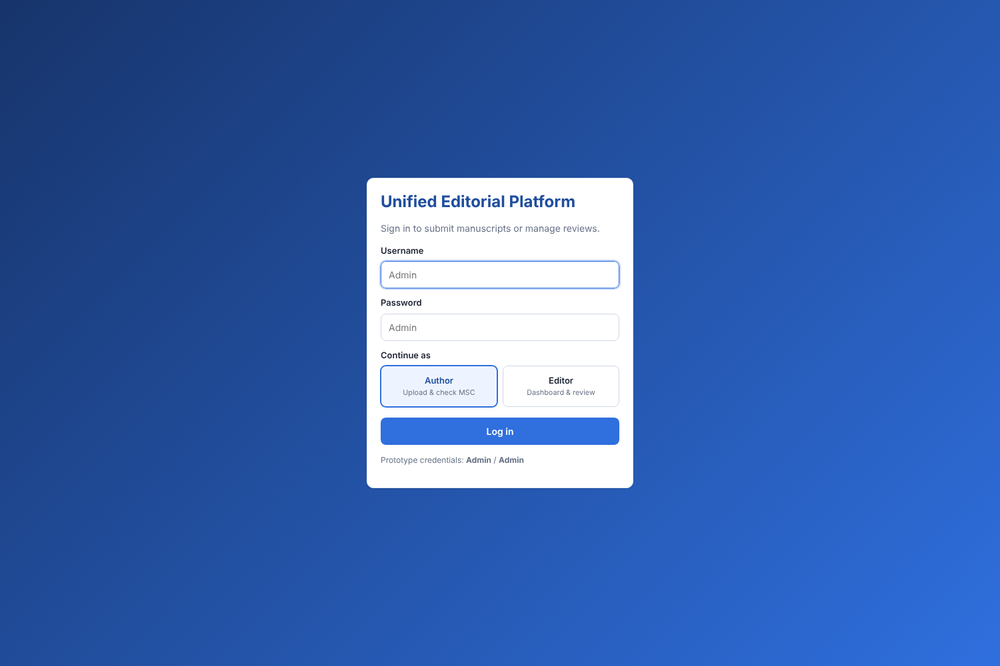

# Unified Editorial Platform: Working Prototype

A working prototype of the Unified Editorial Platform, built with **Node.js + Express**. It covers the full manuscript (MSC) flow:

* **Author view:** log in, choose a journal, download the journal's MSC template, upload an MSC (.docx), get an integrity score from 1 to 10 with actionable feedback, submit it (only above 6), and re-submit after a *Revise* decision.
* **Editor view:** log in, use the MSC dashboard (17-column table, filters, KPIs and charts), look up and assign reviewers in a modal, then review and annotate the immutable MSC and record the final decision (Accept / Reject / Transfer / Revise).


## Quick start

Requirements: **Node.js 18 or newer** (tested on Node 22).

```bash
git clone https://github.com/avishek-tronc/Unified-Editorial-Platform-Prototype.git
cd Unified-Editorial-Platform-Prototype
npm install
npm start
```

Open **http://localhost:3000** and log in with **Admin / Admin**. On the login page, choose **Author** or **Editor** to pick the view.

On the first start the app seeds `data/db.json` with 4 editors, 9 reviewers and 12 manuscripts covering every workflow state, so the dashboard and charts have data straight away.

| Command | What it does |
|---|---|
| `npm start` | Start the server (`PORT` env var, default 3000) |
| `npm run dev` | Start with auto-reload on file changes |
| `npm run reset` | Delete all data and re-seed the demo database |
| `npm test` | End-to-end API smoke test of the author and editor flows (uses a temporary database) |
| `npm run samples` | Regenerate the demo .docx files in `samples/` |

### Demo walkthrough

1. **Author:** log in as Admin/Admin with *Author* selected.
   * Choose a journal (e.g. JACS) and click **Download JACS MSC template**.
   * Upload `samples/sample-msc-fail.docx` (also downloadable from the page). It scores about **4/10: FAIL**, shows feedback for every check, and the submit button is disabled.
   * Upload `samples/sample-msc-pass-JACS.docx`. It scores about **9.9/10: PASS**. Click **Submit MSC for review**.
   * *My submissions* lists your MSCs. A seeded MSC already has a **Revise (Minor)** decision: click **Upload revision** to re-submit it.
2. **Editor:** log out, then log in as Admin/Admin with *Editor* selected.
   * The dashboard shows the new MSC as *Open* with a green time-elapsed badge.
   * Click **Look up reviewer** to open the modal, pick the recommended reviewer and assign them.
   * Click **Review & annotate**. Select text in the manuscript and use **Highlight**, **Underline** or **Comment**. Write general feedback in the left pane. The reading progress is tracked as you scroll.
   * Open the **Decision** tab and choose Accept / Reject / Transfer / Revise. The alternate journal dropdown is only enabled for **Transfer**, and it is pre-filled with the system-proposed journal. **Revise** asks for Minor or Major and sends the MSC back to the author.

> Note: uploading the same manuscript again as a *new* submission is flagged by the plagiarism check, because it matches the earlier submission (duplicate-submission detection). Revisions of the same MSC are excluded from that comparison.

## How the spec maps to the prototype

### Login
* Single prototype account **Admin / Admin**, with a role toggle for the Author and Editor views (`POST /api/login`). Pages and APIs are protected by role.

### Author view: MSC upload page (`/author`)
| Spec item | Implementation |
|---|---|
| Upload MSC in Word format | Drag & drop / file picker. `.docx` up to 15 MB |
| Journal dropdown | 8-journal portfolio (`src/journals.js`) with scope, genre and limits |
| Download a template (e.g. JACS) | `GET /api/template/:journalId` generates a .docx with the required structure, grey placeholders and a *Guidelines & specifications* section |
| Valid format & required details | Rejects non-.docx, legacy .doc, corrupted or renamed files, and documents without a body or under 200 words. Detects title, authors, affiliations, corresponding e-mail, ORCID and required sections |
| Integrity score 1–10 | Weighted score across 7 checks (below). **Above 6 = PASS**, so the author can submit. **6 or below** = the author must apply the feedback and re-submit (submit is blocked server-side too) |
| Score + feedback | Score ring, PASS/FAIL verdict, per-category breakdown, issues ranked critical / major / minor, each with **How to fix** guidance, a journal-fit tab and an MSC details tab |

**Evaluation parameters** (`src/integrity.js`):

| # | Check | Weight | What is evaluated |
|---|---|---|---|
| i | Accuracy & completeness | 25% | Required sections, title length, abstract length and keyword count against journal limits, total word count, leftover template text, reference count, in-text citations ↔ reference list consistency, and quantitative claims in the abstract that are not supported in the body |
| ii | Typos | 10% | Common misspellings with suggestions, repeated words, double spaces, space before punctuation, unbalanced parentheses. Scored by density per 1,000 words |
| iii | Plagiarism | 20% | 8-word shingle similarity against a reference corpus and all prior submissions, with top matching sources and %. Over 25% caps the score at 4 |
| iv | Graphs, figures, equations | 10% | Embedded images vs. "Figure n." captions, sequential numbering, every figure cited, references to missing figures, Word equations referenced, equations typed as plain text |
| v | Table data | 10% | Tables vs. captions, tables pasted as images, empty cells, missing header row, non-numeric values in numeric columns, tables cited in text |
| vi | Technical conformance & identity/authorship integrity | 15% | Author list, affiliations, corresponding e-mail (flags personal domains), ORCID **checksum validation**, duplicate authors, document-metadata creator not in the author list, conflict of interest / data availability / author contributions statements, tracked changes, embedded comments |
| vii | Journal scope fit | 10% | Fitment index (0–100) for every journal in the portfolio from subject-term matching (title, abstract and keywords weighted higher). Recommends the best-fit journal and a **transfer path** when another journal fits clearly better |

Two or more critical issues cap the score at 5.

### Editor view: MSC dashboard (`/dashboard`)
* **Table** with all 17 requested columns: MSC ID, title, brief intro, submitted by, submitted date, integrity check PASSED/FAILED, integrity score, journal fitment index (plus a "better fit" hint), revisions done, assigned editor, assigned reviewer, **reviewer lookup link (modal)**, review status (Open / In Progress / Complete), **time elapsed** colour-coded (green < 8 h, amber 8–24 h, red > 24 h), review start date/time, review progress bar, and a **Review & annotate** link that is only active for Open / In Progress. Final decision is shown as an extra column. Columns are sortable.
* **Filters:** received on (date range), submitted by, pending with (reviewer), assigned/unassigned, time elapsed, journal, review status, feedback incorporation status, final decision, plus free-text search.
* **KPIs & charts** (Chart.js), recalculated for the active filters: time elapsed, final verdict & decision, journal-specific MSCs, assigned vs unassigned, editor-specific load, average time of fulfillment. KPI tiles show totals, delayed, unassigned, average fulfillment time and average integrity score. Clicking a chart segment applies the matching filter.
* **Reviewer selection modal:** reviewers are ranked by availability (free capacity vs. active reviews, on-leave status, expertise in the journal's scope, average turnaround). The top available reviewer is marked *Recommended*. Unavailable reviewers can't be selected.

### MSC review & annotation page (`/review/:id`)
* All MSC details are shown: header metadata, integrity report, version and decision history.
* The **MSC is immutable.** It is rendered read-only from the uploaded .docx and identified by its SHA-256 fingerprint. Annotations are stored separately and anchored by text offset and quote.
* Scroll and read the MSC. Select text to **highlight**, **underline** or **comment**. The **left pane** holds general feedback (auto-saved) and the list of annotations (click to jump, edit, delete).
* **Decision:** ACCEPT / REJECT / TRANSFER / REVISE (Minor or Major).
  * *Transfer:* the page shows the MSC's applicability (fitment index) for the current journal and proposes an alternate journal from the backend journal mapping (genre, context and subject terms plus related-journal mapping). The alternate journal can only be selected, and is only accepted by the API, when the decision is Transfer.
  * *Revise:* the MSC goes back to the author with the reviewer's comments. Feedback incorporation is *In Progress* until the author re-submits. Then it becomes *Complete*, "Revisions done?" increments, and the MSC returns to *Open*.
* Review progress is tracked from reading progress (up to 90%), and a decision completes it (100%). Opening the page moves an Open MSC to In Progress and records the review start time.

## Project structure

```
server.js             Express app: auth, pages, REST API
src/
  integrity.js        MSC integrity engine (format validation + 7 checks + scoring)
  journals.js         Journal portfolio and journal mapping (scope, genre, related journals)
  corpus.js           Reference corpus that stands in for a plagiarism database
  template.js         Journal-specific MSC template (.docx) generator
  service.js          Workflow logic: MSC creation and revision, reviewer proposals, dashboard rows
  seed.js             Demo editors, reviewers and 12 manuscripts in every workflow state
  msc-builder.js      Builds .docx manuscripts (used for seeds and samples)
  png.js              Tiny PNG chart renderer for figures in generated documents
  store.js            JSON-file persistence (data/db.json)
public/               Login, author, dashboard and review pages (vanilla JS + Chart.js)
samples/              Demo MSCs (pass / fail) and the JACS template
scripts/              reset-data, make-samples, smoke-test
docs/screenshots/     Screenshots of the prototype
```

### API overview
| Method & path | Role | Purpose |
|---|---|---|
| `POST /api/login`, `POST /api/logout`, `GET /api/me` | any | Session handling |
| `GET /api/journals`, `GET /api/template/:journalId` | any | Journal portfolio and template download |
| `POST /api/author/check` (multipart `msc`, `journalId`, optional `mscId`) | Author | Run the integrity check |
| `POST /api/author/submit` `{checkId}` | Author | Submit a passed MSC (or revision) |
| `GET /api/author/submissions` | Author | Own MSCs with decisions and reviewer feedback |
| `GET /api/editor/mscs` | Editor | Dashboard data |
| `GET /api/editor/mscs/:id/reviewers`, `POST …/assign` | Editor | Reviewer proposals and assignment |
| `GET /api/mscs/:id`, `POST …/start`, `POST …/progress` | Editor | Review page data, start review, reading progress |
| `POST/PUT/DELETE /api/mscs/:id/annotations[/:aid]`, `PUT …/feedback` | Editor | Annotations and general feedback |
| `POST /api/mscs/:id/decision` | Editor | Final decision |

## Prototype limitations and next steps
* One hard-coded account (Admin/Admin). The Editor login also acts as the reviewer on the review page, and annotations are attributed to the assigned reviewer. Next step: real users and roles (author, editor, reviewer) with SSO.
* The integrity checks are deterministic heuristics so the prototype runs offline. Each check is isolated in `src/integrity.js` so it can be replaced with a production service: a spell/grammar API, Crossref Similarity Check (iThenticate), the ORCID public API, or an ML scope classifier.
* Data is stored in a JSON file. Swap `src/store.js` for a database (e.g. PostgreSQL) for multi-user use.
* Only MSCs that pass the integrity check reach the editorial dashboard (as the spec requires). The Integrity Check column still supports both PASSED and FAILED.
* No e-mail notifications. Authors see decisions and reviewer comments on their *My submissions* list.

## Screenshots
| Login | Author upload & score |
|---|---|
|  |  |
| **Reviewer selection modal** | **Review & annotate** |
|  |  |
